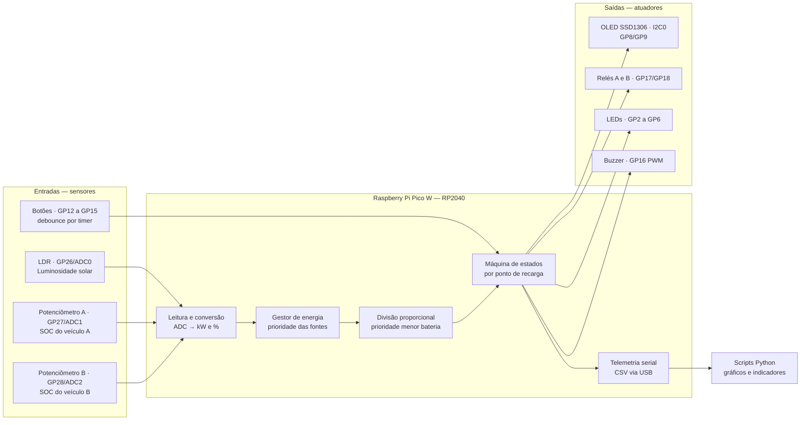
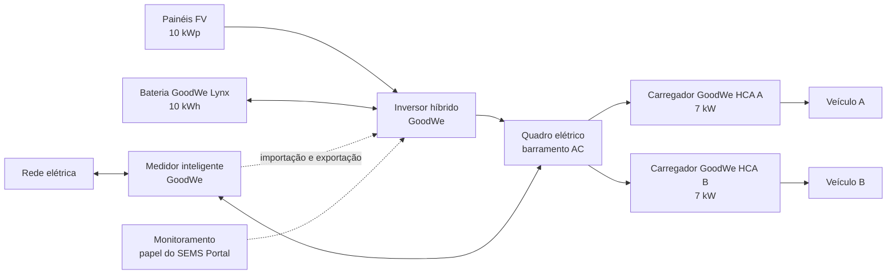
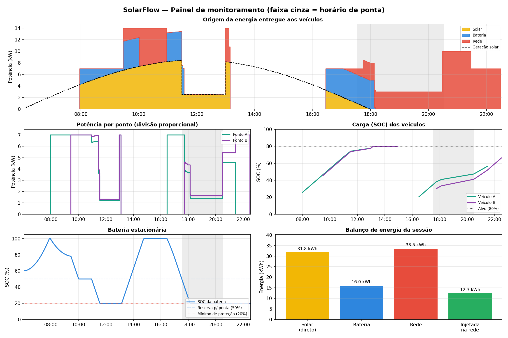
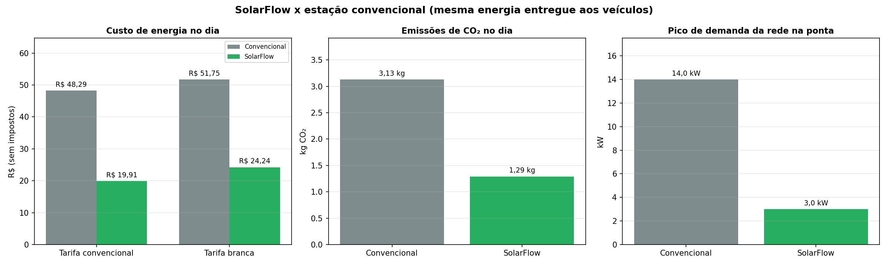

# ⚡ SolarFlow — Estação Inteligente de Recarga com Energia Solar

**Sprint 4 · Solução Final Integrada e Inovadora · Arquitetura de Computadores · FIAP × GoodWe**

Estação de recarga de veículos elétricos com geração solar, bateria estacionária e gestão automática de energia, inspirada no ecossistema GoodWe e simulada no Wokwi com Raspberry Pi Pico W (RP2040) e MicroPython.

| | |
|---|---|
| 🔌 **Simulação no Wokwi** | https://wokwi.com/projects/478074161748924417 |
| 🎥 **Vídeo de demonstração** | *(link do YouTube, adicionado após a gravação)* |
| 📐 **Arquitetura detalhada** | [docs/arquitetura.md](docs/arquitetura.md) |

---

## 👥 Equipe

| Nome | RM |
|---|---|
| Daniel Vieira | 573326 |
| Giovane Salazar | 570396 |
| Gustavo Bitencourt | 568885 |
| Leonardo Takachi | 569066 |

---

## Sumário

1. [Visão geral](#1-visão-geral)
2. [Arquitetura final e integração dos sistemas](#2-arquitetura-final-e-integração-dos-sistemas)
3. [Alinhamento ao desafio GoodWe](#3-alinhamento-ao-desafio-goodwe)
4. [Alinhamento à disciplina de Arquitetura de Computadores](#4-alinhamento-à-disciplina-de-arquitetura-de-computadores)
5. [Resultados quantitativos e qualitativos](#5-resultados-quantitativos-e-qualitativos)
6. [Avaliação crítica: sustentabilidade e inovação](#6-avaliação-crítica-sustentabilidade-e-inovação)
7. [Como executar](#7-como-executar)
8. [Estrutura do repositório](#8-estrutura-do-repositório)
9. [Referências, ferramentas, linguagens e sensores](#9-referências-ferramentas-linguagens-e-sensores)

---

## 1. Visão geral

**O problema.** A recarga de veículos elétricos aumenta o consumo de energia justamente no fim da tarde, quando a rede elétrica já está no seu horário de maior demanda (horário de ponta) e a energia é mais cara. Uma estação que só compra energia da rede desperdiça a oportunidade de usar energia solar e ainda sobrecarrega o sistema elétrico no pior momento.

**A solução.** O SolarFlow é uma estação com dois pontos de recarga que decide sozinha, a cada ciclo, de onde vem a energia e como dividi-la:

- prioriza a **energia solar**, depois a **bateria estacionária** e só então a **rede elétrica**;
- guarda o **excedente solar** na bateria e injeta na rede o que sobrar;
- **limita a rede no horário de ponta** e preserva uma reserva da bateria para esse período;
- divide a potência entre os veículos com **prioridade para quem tem menos bateria**;
- monitora tudo em tempo real (display, LEDs, alertas sonoros e telemetria) e gera gráficos e indicadores automaticamente.

**Principais resultados** (dia útil completo simulado no Wokwi, mesma energia entregue aos veículos):

| Indicador | Estação convencional | SolarFlow | Ganho |
|---|---|---|---|
| Energia comprada da rede | 81,30 kWh | 33,52 kWh | **−58,8%** |
| Custo de energia no dia (tarifa convencional) | R$ 48,29 | R$ 19,91 | **−R$ 28,38** |
| Pico de demanda da rede no horário de ponta | 14,0 kW | 3,0 kW | **−79%** |
| Energia renovável local entregue aos veículos | 0% | 58,8% | — |
| Aproveitamento da geração solar | — | 78,0% | — |

---

## 2. Arquitetura final e integração dos sistemas

### 2.1 Camadas do sistema

| Camada | Função | Implementação |
|---|---|---|
| Geração | Produzir energia renovável | Sensor LDR (luminosidade → irradiância → kW) ou perfil solar do cenário automático |
| Armazenamento | Guardar excedente e suprir déficit | Bateria estacionária modelada em software (SOC, limites de carga e descarga) |
| Recarga | Entregar energia aos veículos | 2 pontos com relés (contatores) e máquina de estados |
| Rede | Complementar e receber excedente | Limite contratado, regra de horário de ponta e injeção do excedente |
| Controle | Decidir e automatizar | Firmware MicroPython no RP2040: gestor de energia + algoritmo de divisão |
| Interface local | Informar o usuário | Display OLED, LEDs de estado e de origem da energia, buzzer |
| Monitoramento | Registrar e analisar | Telemetria CSV pela serial USB + scripts Python de gráficos e indicadores |

### 2.2 Diagrama de controle (hardware e firmware)



### 2.3 Fluxo de energia (sistema real equivalente GoodWe)



### 2.4 Circuito no Wokwi e estação em funcionamento


| Componente | Pino | Periférico do RP2040 | Função |
|---|---|---|---|
| OLED SSD1306 128×64 | GP8 (SDA), GP9 (SCL) | I2C0 | Painel local de status |
| LEDs verdes A e B | GP2, GP3 | GPIO | Estado de cada ponto |
| LEDs amarelo, azul e vermelho | GP4, GP5, GP6 | GPIO | Geração solar, bateria descarregando, rede importando |
| Botões Emergência, Modo, A e B | GP12 a GP15 | GPIO (pull-up) + timer | Comandos do usuário |
| Buzzer | GP16 | PWM | Alertas sonoros |
| Relés A e B | GP17, GP18 | GPIO | Contatores dos pontos |
| Sensor LDR | GP26 | ADC0 | Luminosidade solar |
| Potenciômetros A e B | GP27, GP28 | ADC1, ADC2 | SOC do veículo na conexão |
| Serial Monitor | USB | USB CDC | Telemetria e logs |

### 2.5 Firmware modular

| Arquivo | Responsabilidade |
|---|---|
| `config.py` | Pinos e parâmetros da simulação |
| `sensores.py` | Leitura do ADC, conversões físicas e botões com debounce por interrupção de timer |
| `relogio.py` | Relógio simulado e horário de ponta (Enel SP, 17h30 às 20h30) |
| `ponto_recarga.py` | Máquina de estados de cada ponto (Disponível, Conectado, Carregando, Aguardando, Completo, Emergência) |
| `energia.py` | Bateria estacionária e gestor de energia |
| `algoritmo.py` | Divisão proporcional com prioridade pela menor bateria |
| `atuadores.py` | Relés, LEDs e buzzer não bloqueante |
| `display.py` | Painel de status no OLED |
| `telemetria.py` | Linha de dados CSV por ciclo |
| `cenario.py` | Cenário automático de um dia útil completo |
| `main.py` | Loop principal que integra todos os módulos |

### 2.6 Como a estação decide (a cada ciclo de 0,5 s = 2,5 min simulados)

1. **Regras do momento:** no modo Eco, nada de rede; no horário de ponta, rede limitada a 3 kW; fora da ponta, a bateria guarda uma reserva de 50% para a ponta.
2. **Gestor de energia:** o sol atende os veículos primeiro, a bateria completa o que falta (até o mínimo do momento) e a rede entra só com o restante. O excedente solar carrega a bateria (até 5 kW) e o que sobra é injetado na rede.
3. **Divisão proporcional:** a potência disponível é dividida de forma proporcional à energia que falta a cada veículo, com limite de 7 kW por ponto e redistribuição da sobra. Exemplo: com 10 kW, um veículo em 20% e outro em 60% (alvo 80%) recebem 7 kW e 3 kW.
4. **Atuação:** relés, LEDs, display, alertas e telemetria são atualizados.

O detalhamento completo (lógica de decisão, máquina de estados, sinalização e balanço de energia) está em [docs/arquitetura.md](docs/arquitetura.md).

### 2.7 Automações e alertas

| Situação | Ação automática |
|---|---|
| Início e fim do horário de ponta | Ajusta o limite da rede e a reserva da bateria, com alerta sonoro |
| Bateria no mínimo do momento | Para de descarregar; a rede (ou a espera, no modo Eco) assume |
| Energia disponível abaixo de 0,1 kW | Veículos passam para "aguardando energia" |
| Excedente solar | Carrega a bateria e injeta o restante na rede |
| Veículo atinge 80% | Relé abre e a recarga é encerrada |
| Botão de emergência | Todos os relés abrem na hora e novas conexões ficam bloqueadas |

### 2.8 Monitoramento e cenário automático

A cada ciclo, a estação envia pela serial uma linha `DADOS,...` com 18 grandezas (geração, origem da energia, bateria, estado, SOC e potência de cada ponto). O script `analise/graficos.py` transforma esses dados em gráficos, e o `analise/resultados.py` calcula os indicadores e compara com uma estação convencional.

Com `CENARIO_AUTOMATICO = True`, a estação simula sozinha um dia útil completo (06h às 24h em cerca de 4 minutos): sol nascendo e se pondo, nuvens ao meio-dia, dois veículos pela manhã, modo Eco entre 11h e 13h e dois veículos no fim da tarde, um deles chegando em pleno horário de ponta. Isso torna os resultados **reproduzíveis**.

---

## 3. Alinhamento ao desafio GoodWe

### 3.1 Tecnologias GoodWe e o papel de cada uma

| Parte do sistema | Tecnologia GoodWe equivalente | Por que essa escolha |
|---|---|---|
| Pontos de recarga | **Carregador EV GoodWe série HCA (7 kW)** | É exatamente o tipo de carregador que a lógica do SolarFlow comanda: recarga com excedente solar, gerenciamento de carga, parada de emergência e monitoramento pelo portal. A potência de 7 kW por ponto usada na simulação vem desse modelo. |
| Conversão e integração | **Inversor híbrido GoodWe** | Integra painéis, bateria e rede em um só equipamento, que é a arquitetura modelada pelo gestor de energia. |
| Armazenamento | **Bateria GoodWe Lynx Home** | Guarda o excedente solar do dia para usar quando não há sol e no horário de ponta. |
| Medição | **Medidor inteligente GoodWe** | Mede importação e exportação na entrada da rede, informação que viabiliza a recarga por excedente. |
| Monitoramento | **SEMS Portal e app GoodWe** | A telemetria e os gráficos do SolarFlow cumprem o papel que o SEMS Portal tem no ecossistema real. |

Os carregadores da série HCA trazem, de fábrica, as funções que o SolarFlow implementa e demonstra: recarga com excedente fotovoltaico, gerenciamento de carga, parada de emergência, integração direta com o sistema GoodWe e acompanhamento das recargas pelo SEMS Portal e pelo app. Isso torna o projeto uma **prova de conceito da inteligência de controle** que roda sobre esse hardware.

### 3.2 Como cada item resolve um ponto-chave do desafio

| Ponto-chave do desafio | Como o SolarFlow resolve | Evidência |
|---|---|---|
| Geração de energia renovável | Sensor de luminosidade convertido em potência fotovoltaica e perfil solar diário | Gráfico "Origem da energia" e coluna `solar_kw` da telemetria |
| Armazenamento | Bateria com limites de carga, descarga e SOC mínimo, carregada só pelo sol | Gráfico "Bateria estacionária"; 16,00 kWh entregues pela bateria |
| Uso otimizado da energia | Gestor com prioridade solar → bateria → rede e excedente para bateria ou rede | 58,8% de energia renovável local; 78,0% da geração solar aproveitada |
| Monitoramento inteligente | Display, LEDs de origem, alertas e telemetria com 396 registros por dia | Painel de monitoramento e `telemetria.csv` |
| Algoritmos inteligentes | Divisão proporcional, reserva para a ponta e limite de ponta | Bancada de testes (seção 5.4) |
| Automações avançadas | Alertas e mudanças de regra sem intervenção; cenário automático | Logs do Serial Monitor e seção 2.7 |
| Interface amigável | Display com hora, modo, sol, bateria, estado e potência dos pontos; LEDs e sons com significado definido | Vídeo e seção 11 de `docs/arquitetura.md` |
| Visualização de dados | 7 gráficos gerados automaticamente, com as mesmas cores dos LEDs | Pasta `analise/graficos/` |
| Segurança | Parada de emergência global, relé fechado só durante a recarga, proteção da bateria | Máquina de estados e logs de emergência |

---

## 4. Alinhamento à disciplina de Arquitetura de Computadores

O projeto foi construído sobre conceitos da disciplina, e várias decisões de design só fazem sentido à luz deles:

| Conceito | Onde aparece no SolarFlow | Decisão tomada |
|---|---|---|
| **Microcontrolador × microprocessador** | RP2040: dois núcleos ARM Cortex-M0+ (até 133 MHz) e 264 KB de SRAM em um único chip, com periféricos integrados | Um microcontrolador é suficiente e mais adequado para controle em tempo real de baixo consumo |
| **Conversão analógico-digital** | ADC de 12 bits: 4.096 níveis, resolução de cerca de 0,8 mV em 3,3 V; o MicroPython entrega a leitura escalada para 16 bits (`read_u16`) | Conversão em cadeia: leitura → tensão → resistência do LDR (divisor de tensão) → lux → irradiância → kW |
| **Recursos limitados de hardware** | A placa Pico W expõe apenas 3 entradas ADC (GP26 a GP28); o GP29 mede a alimentação | Os 3 canais ficam para grandezas externas; o SOC durante a recarga é calculado em software |
| **Filtragem de sinal** | Média de 4 amostras por leitura analógica | Reduz ruído do ADC com custo computacional mínimo |
| **GPIO e resistores de pull-up** | Botões com pull-up interno, ativos em nível baixo | Dispensa resistores externos |
| **Interrupções** | Interrupção de timer a cada 10 ms lê os quatro botões; um clique só vale após 3 leituras estáveis (30 ms) | Elimina repiques ao apertar e ao soltar; a rotina de interrupção é curta e não aloca memória, como exige uma ISR |
| **Barramento I2C** | Display SSD1306 em 2 fios a 400 kHz; o quadro de 128×64 pixels ocupa 1.024 bytes de RAM (framebuffer) | Enviar 1.024 bytes leva cerca de 23 ms (9 bits por byte a 400 kHz); por isso o display é redesenhado a cada 500 ms, e não a cada iteração |
| **PWM** | Buzzer com frequência variável | Cada evento tem um som próprio |
| **Execução não bloqueante** | Laço principal de 20 ms; buzzer com fila de notas; ciclo de simulação a cada 500 ms | Nenhuma tarefa trava as outras (escalonamento cooperativo) |
| **Representação numérica** | O Cortex-M0+ não tem unidade de ponto flutuante (FPU); operações com `float` são emuladas em software e sujeitas a arredondamento | Um erro real de arredondamento (SOC parando em 79,99999%) foi corrigido com tolerância de 1 Wh |
| **Comunicação serial** | Telemetria pela USB (classe CDC, serial virtual), sem ocupar pinos de GPIO | Separa o canal de dados do hardware de campo |
| **Isolamento de potência** | Relés separam o circuito de controle (3,3 V) do circuito de potência (alimentação em 5 V pelo VBUS) | Mesmo princípio de um contator em um carregador real |
| **Modularização e integração hardware/software** | 11 módulos com responsabilidades separadas; os mesmos módulos rodam no Pico e no PC (bancada de testes) | Facilita testes, manutenção e evolução |

---

## 5. Resultados quantitativos e qualitativos

Resultados de um dia útil completo executado no Wokwi com o cenário automático (06h02 às 22h32, 396 registros de telemetria).

### 5.1 Painel de monitoramento



O painel mostra a estratégia funcionando ao longo do dia: o sol carrega a bateria antes dos veículos chegarem; a reserva de 50% é respeitada às 10h; o modo Eco, entre 11h e 13h, carrega apenas com sol e bateria (inclusive durante as nuvens do meio-dia); o excedente da tarde enche a bateria e é injetado na rede; no horário de ponta (faixa cinza), a rede fica limitada a 3 kW e a bateria é usada até o mínimo de proteção.

### 5.2 Energia e aproveitamento solar

| Fonte da energia entregue aos veículos | Energia (kWh) | Participação |
|---|---|---|
| Solar direto | 31,78 | 39,1% |
| Bateria (carregada pelo sol) | 16,00 | 19,7% |
| Rede elétrica | 33,52 | 41,2% |
| **Total** | **81,30** | **58,8% de energia renovável local** |

| Indicador | Valor |
|---|---|
| Geração solar total | 56,09 kWh |
| Usada nos veículos ou guardada na bateria | 43,78 kWh (78,0%) |
| Excedente injetado na rede | 12,32 kWh (22,0%) |

### 5.3 Comparação com uma estação convencional



| Estação | Energia comprada da rede (kWh) | Custo, tarifa convencional (R$) | Custo, tarifa branca (R$) | CO₂ (kg) |
|---|---|---|---|---|
| Convencional | 81,30 | 48,29 | 51,75 | 3,13 |
| SolarFlow | 33,52 | 19,91 | 24,24 | 1,29 |

| Ganho do SolarFlow | Valor |
|---|---|
| Redução da energia comprada da rede | 47,78 kWh (58,8%) |
| Economia no dia, tarifa convencional | R$ 28,38 (58,8%) |
| Economia no dia, tarifa branca | R$ 27,51 (53,2%) |
| Economia projetada no ano (250 dias úteis, tarifa convencional) | R$ 7.094,87 |
| CO₂ evitado no dia / projetado no ano | 1,84 kg / 460 kg |
| Pico de demanda da rede no horário de ponta | 14,0 kW → 3,0 kW (79% menor) |
| Energia da rede consumida no horário de ponta | 12,05 kWh → 8,53 kWh |

| Sessão | Chegada | SOC na chegada | Saída | SOC na saída | Energia (kWh) |
|---|---|---|---|---|---|
| A (manhã) | 08:00 | 25% | 14:00 | 80% | 27,50 |
| B (manhã) | 09:30 | 45% | 15:00 | 80% | 17,50 |
| A (fim da tarde) | 16:30 | 20% | 21:30 | 56% | 18,18 |
| B (ponta) | 17:47 | 30% | 22:32 | 66% | 18,12 |

*Premissas: tarifas de referência da Enel SP sem impostos (convencional R$ 0,594/kWh; tarifa branca R$ 1,115 na ponta, R$ 0,724 no intermediário e R$ 0,499 fora da ponta); horário de ponta da Enel SP das 17h30 às 20h30; fator médio de emissão do SIN de 0,0385 kg CO₂/kWh (MCTI, 2023); a estação convencional entrega a mesma energia nos mesmos horários, comprando tudo da rede.*

### 5.4 Bancada de testes: o efeito de cada decisão do projeto

A bancada (`analise/bancada.py`) executa os **mesmos módulos do firmware** no computador e isola o efeito de cada estratégia. No Teste 1, ela reproduz o dia do Wokwi com diferença inferior a 0,3%.

**Teste 1: dia completo**

| Estratégia | Comprada da rede (kWh) | Rede na ponta (kWh) | Pico na ponta (kW) | Custo, tarifa convencional (R$) | SOC na saída (A, B, A, B) |
|---|---|---|---|---|---|
| SolarFlow completo | 33,53 | 8,53 | 3,0 | 19,92 | 80%, 80%, 56%, 66% |
| Divisão igual (sem prioridade) | 33,39 | 8,53 | 3,0 | 19,83 | 80%, 80%, 58%, 64% |
| Sem reserva para a ponta | 31,77 | 8,53 | 3,0 | 18,87 | 80%, 80%, 56%, 66% |
| Estação convencional (sem sol, sem bateria, sem limite) | 100,00 | 40,25 | 14,0 | 59,40 | 80%, 80%, 80%, 80% |

**Teste 2: prioridade pela menor bateria.** Dois veículos chegam juntos às 21h30 (A com 20%, B com 60%) e saem juntos às 23h30, com 10 kW de rede e bateria vazia.

| Divisão | SOC de A na saída | SOC de B na saída | Menor SOC na saída |
|---|---|---|---|
| **Proporcional (SolarFlow)** | 47% | 72% | **47%** |
| Igual | 40% | 80% | 40% |

**Teste 3: reserva da bateria para a ponta.** Bateria cheia às 15h; o veículo A carrega das 15h30 às 17h30 e o veículo B chega às 17h30, início da ponta, e sai às 20h30.

| Estratégia | Energia entregue a B na ponta (kWh) | SOC de B na saída | Rede na ponta (kWh) |
|---|---|---|---|
| **Com reserva (SolarFlow)** | 11,42 | 53% | 8,12 |
| Sem reserva | 9,73 | 49% | 8,75 |

### 5.5 Resultados qualitativos

- **Funcionamento integrado verificado:** sensores, gestor de energia, algoritmo, máquina de estados, atuadores, display e telemetria operam juntos, em tempo real, no mesmo laço.
- **Conservação de energia validada:** a energia solar gerada é igual à soma do que foi para os veículos, para a bateria e para a rede; a carga menos a descarga da bateria é igual à variação do SOC; os totais calculados a partir da telemetria batem com os acumulados internos do gestor.
- **Reprodutibilidade:** o cenário automático e a bancada geram os mesmos resultados a cada execução.
- **Comportamento seguro:** a emergência abre os relés imediatamente e bloqueia novas conexões; a bateria nunca desce abaixo de 20%.
- **Interface clara:** cada LED e cada som tem um significado definido, e o display mostra em uma tela o estado completo da estação.

---

## 6. Avaliação crítica: sustentabilidade e inovação

### 6.1 Benefícios de sustentabilidade

- **Ambientais:** 58,8% da energia entregue aos veículos veio do sol, diretamente ou pela bateria, e 78% da geração solar foi aproveitada no próprio local. A estação deixa de comprar 47,8 kWh por dia da rede.
- **Econômicos:** economia de R$ 28,38 por dia, ou R$ 7.094,87 por ano em dias úteis, com tarifa convencional e sem impostos.
- **Sociais e para a rede elétrica:** o pico de demanda no horário de ponta caiu de 14 kW para 3 kW (79% menor). Em escala, estações que não sobrecarregam a rede no fim da tarde reduzem a necessidade de reforços na infraestrutura e o despacho de usinas mais caras nesse horário, benefício que alcança todos os consumidores.

### 6.2 Leitura crítica dos números

- **O ganho de CO₂ é pequeno em valor absoluto,** e isso é esperado: a matriz elétrica brasileira já é majoritariamente renovável (88,2% em 2024, segundo a EPE), com fator médio de emissão de apenas 0,0385 kg CO₂/kWh em 2023. O benefício climático mais relevante está em viabilizar a eletrificação dos veículos com energia limpa e em aliviar a rede na ponta. Usamos o fator de 2023 por ser o anual oficial mais recente; os fatores mensais de 2025 são ainda menores, o que tornaria a estimativa de CO₂ evitado mais conservadora.
- **Há um trade-off claro na ponta:** os veículos do fim da tarde saíram com 56% e 66% de carga, abaixo do alvo de 80%, porque a rede ficou limitada a 3 kW. A estação troca velocidade de recarga por custo menor e alívio da rede. Em uma aplicação real, esse limite deve ser configurável pelo operador.
- **A tarifa branca não compensou neste perfil de uso:** com recargas concentradas no fim da tarde, ela saiu mais cara que a convencional, para as duas estações. A escolha da modalidade tarifária depende do perfil de uso.
- **Cada estratégia tem um efeito específico:** a prioridade pela menor bateria aumentou o menor SOC de saída de 40% para 47% quando os veículos saem juntos (Teste 2), e a reserva para a ponta entregou 17% mais energia no horário de ponta, comprando 7% menos da rede nesse período (Teste 3). Já no dia completo (Teste 1), a reserva custou cerca de R$ 1 a mais por dia na tarifa convencional, e a divisão igual favoreceu levemente o veículo que saiu primeiro. Isso mostra que a próxima evolução natural é considerar o **horário de saída** de cada veículo.

### 6.3 Limitações da simulação

- A conversão de luminosidade (lux) para irradiância (W/m²) é uma aproximação; um sistema real mediria a potência no inversor.
- O modelo não inclui perdas de conversão, eficiência de ida e volta da bateria nem sua degradação.
- As tarifas são valores de referência sem impostos e sem bandeiras tarifárias, e a energia injetada na rede não foi monetizada (estimativa conservadora).
- Os resultados vêm de um cenário de um dia útil; a projeção anual supõe dias semelhantes.

### 6.4 Diferenciais inovadores

- **Gestão de energia com três fontes** e destino inteligente do excedente.
- **Reserva da bateria para o horário de ponta** (*peak shaving*), com regras que mudam sozinhas conforme o horário e o modo.
- **Divisão proporcional com prioridade pela menor bateria**, com limite por ponto e redistribuição da sobra.
- **Modo Eco**, que carrega apenas com energia renovável.
- **Horário de ponta real da distribuidora** (Enel SP) e tarifas reais nos cálculos.
- **Telemetria e análise automáticas,** com indicadores de custo, CO₂ e demanda.
- **Bancada de testes reaproveitando o próprio firmware,** que mede o efeito de cada decisão do projeto.
- **Cenário automático reproduzível** para demonstração e validação.

### 6.5 Próximos passos

- Prioridade que considere o **horário de saída** informado pelo motorista.
- **Reserva dinâmica** da bateria com base em previsão de geração solar e de demanda.
- Envio da telemetria por **Wi-Fi/MQTT** (o Pico W já tem o rádio) para um painel online, no papel do SEMS Portal.
- Comunicação padronizada com carregadores reais, como o protocolo OCPP.

### 6.6 Objetivos de Desenvolvimento Sustentável (ONU)

- **ODS 7 – Energia limpa e acessível:** mais energia solar na recarga e menor custo.
- **ODS 9 – Indústria, inovação e infraestrutura:** alívio da rede no horário de ponta.
- **ODS 11 – Cidades e comunidades sustentáveis:** infraestrutura de recarga para a mobilidade elétrica urbana.
- **ODS 13 – Ação contra a mudança global do clima:** redução de emissões na recarga.

---

## 7. Como executar

### Simulação no Wokwi

1. Abra o projeto: https://wokwi.com/projects/478074161748924417
2. Clique em ▶. Com `CENARIO_AUTOMATICO = True` (padrão), a estação simula um dia útil completo sozinha, em cerca de 4 minutos.
3. Para o modo manual, troque para `CENARIO_AUTOMATICO = False` no `config.py`: o LDR controla o sol, os potenciômetros definem o SOC dos veículos e os botões conectam, alternam o modo e acionam a emergência.

### Análise dos dados (computador)

```bash
pip install pandas matplotlib
cd analise
# cole o texto do Serial Monitor do Wokwi em telemetria.txt
python resultados.py   # gera graficos/, telemetria.csv e resultados.md
python bancada.py      # testes das estratégias (gera bancada.md)
```

---

## 8. Estrutura do repositório

```
├── README.md
├── docs/
│   ├── arquitetura.md          # arquitetura detalhada, diagramas e decisões
│   └── imagens/                # prints do circuito e da simulação
├── firmware/                   # código MicroPython do Raspberry Pi Pico W
│   ├── main.py, config.py, sensores.py, relogio.py, ponto_recarga.py
│   ├── energia.py, algoritmo.py, atuadores.py, display.py
│   ├── telemetria.py, cenario.py, ssd1306.py
│   └── testes/teste_hardware.py
├── wokwi/
│   └── diagram.json            # circuito do Wokwi
└── analise/                    # análise dos dados no computador
    ├── graficos.py, resultados.py, bancada.py
    ├── telemetria.txt, telemetria.csv
    ├── resultados.md, bancada.md
    └── graficos/               # imagens geradas
```

---

## 9. Referências, ferramentas, linguagens e sensores

### Linguagens, frameworks e ferramentas

| Item | Uso no projeto |
|---|---|
| MicroPython (v1.28) | Firmware da estação |
| Python 3 | Análise dos dados e bancada de testes |
| pandas | Tratamento da telemetria |
| matplotlib | Geração dos gráficos |
| Wokwi | Simulação do hardware |
| Mermaid | Diagramas de arquitetura renderizados no GitHub |
| Git e GitHub | Versionamento e documentação |

### Hardware e sensores (simulados)

| Componente | Função |
|---|---|
| Raspberry Pi Pico W (RP2040) | Microcontrolador da estação |
| Módulo fotoresistor (LDR) | Luminosidade solar |
| 2 potenciômetros | SOC dos veículos na conexão |
| Display OLED SSD1306 (I2C) | Interface local |
| 2 módulos de relé | Contatores dos pontos de recarga |
| 5 LEDs com resistores de 220 Ω | Estado dos pontos e origem da energia |
| 4 botões | Emergência, modo e conexão dos veículos |
| Buzzer (PWM) | Alertas sonoros |

### Referências

- GoodWe, carregador EV série HCA (G2), ficha do produto (distribuidor Krannich Solar): https://shop.krannich-solar.com/en-au/GW7K-HCA-20/6662080
- GoodWe, carregador EV GW7K-HCA, ficha do produto (distribuidor Krannich Solar): https://shop.krannich-solar.com/de-en/e-mobility/charging-stations/42618/ev-charger-gw-7k-hca
- Canal Solar, *Tarifa branca: conceitos e especificações na medição de energia* (postos tarifários e tarifas de referência da Enel SP): https://canalsolar.com.br/tarifa-branca-conceitos-e-especificacoes-na-medicao-de-energia-eletrica
- Idec, *Tarifa branca* (horário de ponta em São Paulo): https://idec.org.br/node/26342
- O Setor Elétrico, *Geração de energia elétrica tem a menor emissão de CO₂ dos últimos onze anos* (fator de emissão do SIN 2023, dados do MCTI): https://www.osetoreletrico.com.br/?p=159478
- Cenário Energia, *Brasil reduz intensidade de carbono na geração elétrica* (fatores de 2025 e participação renovável de 2024, dados do MCTI e da EPE): https://cenarioenergia.com.br/2025/06/13/brasil-reduz-intensidade-de-carbono-na-geracao-eletrica-com-inclusao-de-novas-renovaveis-na-base-de-calculo-oficial/
- Raspberry Pi, *RP2040 Datasheet*: https://datasheets.raspberrypi.com/rp2040/rp2040-datasheet.pdf
- Raspberry Pi, *Pico W Datasheet*: https://datasheets.raspberrypi.com/picow/pico-w-datasheet.pdf
- MicroPython, documentação da porta RP2: https://docs.micropython.org/en/latest/rp2/quickref.html
- micropython-lib, driver SSD1306 (licença MIT): https://github.com/micropython/micropython-lib
- Wokwi, documentação: https://docs.wokwi.com
