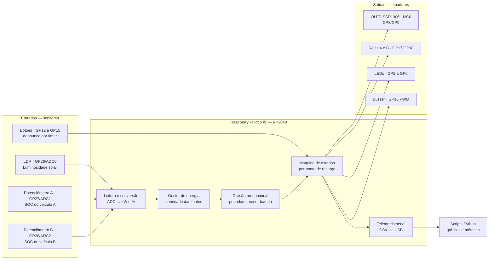
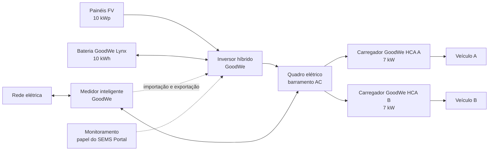
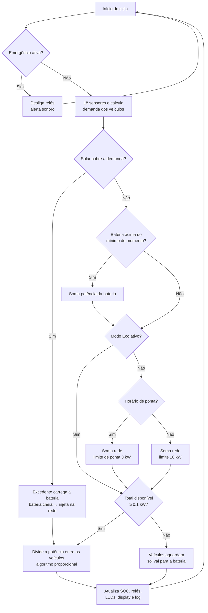
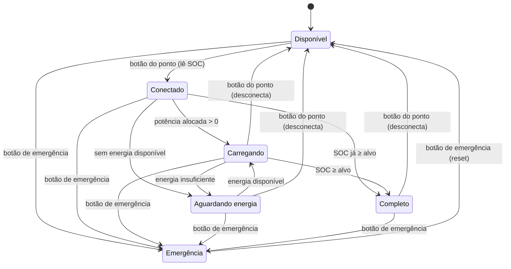

# Arquitetura da Solução — SolarFlow

Estação inteligente de recarga de veículos elétricos com geração solar, armazenamento em bateria e gestão automática de energia, baseada no ecossistema GoodWe e simulada no Wokwi com Raspberry Pi Pico W (RP2040) e MicroPython.

## 1. Visão geral

A estação possui **dois pontos de recarga** alimentados por três fontes, nesta ordem de prioridade:

1. **Energia solar** (painéis fotovoltaicos + inversor híbrido)
2. **Bateria estacionária** (armazena o excedente solar)
3. **Rede elétrica** (complemento, com restrição no horário de ponta)

Quando os veículos e a bateria não conseguem absorver toda a geração solar, o excedente é **injetado na rede**, gerando créditos de energia.

Um microcontrolador lê os sensores, decide de onde vem a energia, divide a potência entre os veículos com prioridade para quem tem menos bateria, aciona os contatores (relés) e envia telemetria para análise.

## 2. Camadas do sistema

| Camada | Função | Implementação na simulação |
|---|---|---|
| Geração | Produzir energia renovável | Sensor LDR mede a luminosidade, convertida em irradiância e geração (kW) |
| Armazenamento | Guardar excedente e suprir déficit | Bateria modelada em software (SOC, carga e descarga) |
| Recarga | Entregar energia aos veículos | 2 pontos de recarga com relés (contatores) |
| Rede | Complementar quando falta energia e receber o excedente | Limite contratado + regra de horário de ponta + injeção do excedente |
| Controle | Decidir e automatizar | Firmware MicroPython no RP2040 |
| Interface local | Informar o usuário | Display OLED, LEDs e buzzer |
| Monitoramento | Registrar e analisar dados | Telemetria serial (CSV) + scripts Python de gráficos |

## 3. Mapeamento com as tecnologias GoodWe

| Parte do sistema | Na simulação | Equivalente GoodWe | Por que essa tecnologia |
|---|---|---|---|
| Geração solar | LDR (luminosidade → irradiância) | Painéis FV + inversor híbrido GoodWe | O inversor híbrido integra FV, bateria e rede em um único equipamento |
| Armazenamento | Modelo de bateria em software | Bateria GoodWe Lynx Home | Guarda o excedente do dia para recarga quando não há sol |
| Pontos de recarga | Relés + lógica de alocação | Carregador GoodWe EV linha HCA (7 kW) | Suporta recarga por excedente solar e gerenciamento de carga |
| Medição de excedente | Calculada em software (geração − consumo) | Medidor inteligente GoodWe | Mede importação e exportação na entrada da rede; base da recarga por excedente |
| Gestão de energia | Algoritmo no RP2040 | Gerenciamento de carga do sistema GoodWe | Mesma lógica: priorizar solar e respeitar limites de potência |
| Parada de emergência | Botão de emergência | Parada de emergência do carregador HCA | Segurança: corta a recarga imediatamente |
| Monitoramento | Display + telemetria CSV + gráficos | SEMS Portal e app GoodWe | Acompanhamento dos processos de recarga e dos fluxos de energia |

## 4. Parâmetros da simulação

Todos ficam no arquivo `config.py` e podem ser ajustados.

| Parâmetro | Valor padrão |
|---|---|
| Potência solar máxima (irradiância 100%) | 10 kWp |
| Capacidade da bateria estacionária | 10 kWh |
| Potência máx. de carga/descarga da bateria | 5 kW |
| SOC inicial da bateria estacionária | 60% |
| SOC mínimo da bateria (proteção) | 20% |
| Reserva da bateria para a ponta (modo Normal, fora da ponta) | 50% |
| Potência máxima por ponto de recarga | 7 kW (referência: GoodWe HCA 7 kW) |
| Potência mínima para recarregar | 0,1 kW (abaixo disso os veículos aguardam) |
| Capacidade da bateria de cada veículo | 50 kWh |
| SOC alvo de cada veículo | 80% |
| Limite de importação da rede (fora de ponta) | 10 kW |
| Limite de importação da rede (horário de ponta) | 3 kW |
| Horário de ponta | 17h30 às 20h30 (Enel SP) |
| Escala de tempo | 1 s real = 5 min simulados |
| Horário inicial do relógio simulado | 16h no modo manual; 06h no cenário automático |

**Relógio simulado e irradiância:** o relógio simulado controla as regras de tarifa (horário de ponta). No modo manual, a irradiância vem do sensor LDR, ajustado no Wokwi de forma independente do relógio, o que permite reproduzir qualquer condição (sol forte, nublado, sem sol) no momento desejado da demonstração. No cenário automático (seção 15), a irradiância segue um perfil solar ao longo do dia.

**Modos de operação (botão Modo):**

| Modo | Fontes permitidas para a recarga |
|---|---|
| Normal | Solar + bateria + rede (com limite reduzido no horário de ponta). Fora da ponta, a bateria só descarrega até 50%: o restante fica guardado para a ponta, quando a energia da rede é mais cara (*peak shaving*) |
| Eco | Somente solar + bateria (até 20%); sem energia renovável suficiente, a recarga reduz ou pausa |

Atualização do SOC a cada ciclo:

```
ΔSOC (%) = (Potência recebida (kW) × Δt (h) / Capacidade (kWh)) × 100
```

## 5. Hardware e mapa de pinos (Raspberry Pi Pico W)

| Componente (Wokwi) | Pino | Periférico do RP2040 | Função |
|---|---|---|---|
| Serial Monitor (Wokwi) | USB | USB CDC (serial virtual) | Telemetria CSV e console |
| OLED SSD1306 128×64 | GP8 (SDA), GP9 (SCL) | I2C0 | Painel local de status |
| LED verde — ponto A | GP2 | GPIO saída | Ponto A carregando |
| LED verde — ponto B | GP3 | GPIO saída | Ponto B carregando |
| LED amarelo | GP4 | GPIO saída | Geração solar ativa |
| LED azul | GP5 | GPIO saída | Bateria descarregando |
| LED vermelho | GP6 | GPIO saída | Importando energia da rede |
| Botão emergência | GP12 | GPIO entrada (pull-up) | Parada de emergência |
| Botão modo | GP13 | GPIO entrada (pull-up) | Alterna Modo Normal / Modo Eco |
| Botão ponto A | GP14 | GPIO entrada (pull-up) | Conectar/desconectar veículo A |
| Botão ponto B | GP15 | GPIO entrada (pull-up) | Conectar/desconectar veículo B |
| Buzzer | GP16 | PWM | Alertas sonoros |
| Relé — ponto A | GP17 | GPIO saída | Contator do ponto A |
| Relé — ponto B | GP18 | GPIO saída | Contator do ponto B |
| Sensor LDR (módulo) | GP26 | ADC0 | Luminosidade (lux) → irradiância solar |
| Potenciômetro A | GP27 | ADC1 | SOC do veículo A na conexão |
| Potenciômetro B | GP28 | ADC2 | SOC do veículo B na conexão |

Todos os LEDs usam resistor de 220 Ω. Sensores analógicos e display alimentados em 3V3; módulos de relé alimentados em 5 V (VBUS).

### Decisões de arquitetura

- **Limite de canais ADC:** o RP2040 tem 4 canais ADC externos (GP26 a GP29) e um sensor de temperatura interno, mas na placa Pico W o GP29 é usado internamente para medir a tensão de alimentação. Sobram 3 entradas analógicas (GP26, GP27, GP28). Por isso, os sensores analógicos ficam para as grandezas que vêm "de fora" (sol e SOC na conexão), e o SOC durante a recarga e o SOC da bateria estacionária são calculados em software.
- **ADC de 12 bits:** o MicroPython entrega a leitura em 16 bits (`read_u16`, 0 a 65535), que é convertida para porcentagem e para kW.
- **Telemetria via USB:** o MicroPython envia o `print()` pela USB da placa (serial virtual CDC), sem ocupar pinos de GPIO. É por esse canal que sai o CSV usado nos resultados e gráficos.
- **I2C para o display:** usa só 2 fios (GP8 e GP9, também ligados ao I2C0) para um display completo, economizando pinos.
- **PWM para o buzzer:** permite gerar tons diferentes para cada tipo de alerta.
- **Pull-up interno nos botões:** dispensa resistores externos; o botão fecha o contato com o GND.
- **Debounce por interrupção de timer:** um timer gera uma interrupção a cada 10 ms que lê os quatro botões. Um clique só é aceito depois de 3 leituras iguais seguidas (30 ms estável), o que elimina os repiques mecânicos ao apertar e ao soltar. A rotina de interrupção é curta e não aloca memória.
- **Conversão do LDR:** o LDR mede luminosidade, não potência. A leitura do ADC vira tensão, a tensão vira a resistência do LDR (divisor de tensão com resistor de 10 kΩ), a resistência vira lux (curva característica do LDR) e o lux vira irradiância pela aproximação sol pleno ≈ 100.000 lux ≈ 1.000 W/m². A geração é proporcional à irradiância: 1.000 W/m² = 10 kW.
- **Filtro por média:** cada leitura analógica é a média de 4 amostras, reduzindo ruído do ADC.
- **Relés como contatores:** isolam o circuito de controle (3,3 V) do circuito de potência, como em um carregador real.

## 6. Diagrama de arquitetura (controle)



## 7. Fluxo de energia (sistema real equivalente)

Os carregadores HCA são AC e ficam ligados ao quadro elétrico, em paralelo com a rede. O inversor híbrido converte a energia dos painéis e da bateria para AC e entrega no mesmo quadro. O medidor inteligente, na entrada da rede, mede importação e exportação: é essa medição que permite saber quanto excedente solar existe para a recarga.



## 8. Lógica de decisão a cada ciclo

A rede entra apenas com a parte que ainda falta depois de solar e bateria. O mínimo da bateria depende do momento: 20% no modo Eco ou no horário de ponta, e 50% no modo Normal fora da ponta (reserva para a ponta).



## 9. Máquina de estados de cada ponto de recarga



A emergência é global: desliga os dois pontos ao mesmo tempo e bloqueia novas conexões até o reset. Depois do reset, os veículos precisam ser reconectados.

## 10. Algoritmo de divisão proporcional com prioridade pela menor bateria

A potência disponível é dividida de forma proporcional à **energia que falta** para cada veículo chegar ao SOC alvo. Quem tem menos bateria precisa de mais energia, então recebe uma fatia maior.

1. Para cada veículo conectado: `falta_i = (alvo − SOC_i) × capacidade` (energia que falta, em kWh)
2. Peso de cada veículo: `peso_i = falta_i / soma(falta)`
3. Potência alocada: `P_i = P_disponível × peso_i`, limitada a 7 kW por ponto
4. Se algum ponto bater no limite, a sobra é redistribuída entre os demais

O limite de cada ponto em um ciclo é o menor valor entre 7 kW e a energia que falta dividida pelo tempo do ciclo, para que o veículo nunca ultrapasse o SOC alvo.

**Exemplo:** 10 kW disponíveis, veículo A com 20% e veículo B com 60% (alvo 80%).
Faltas: A = 30 kWh, B = 10 kWh → pesos 75% e 25% → A = 7,5 kW (limitado a 7 kW), B = 2,5 kW → a sobra de 0,5 kW vai para B → **A = 7 kW, B = 3 kW**.

## 11. Sinalização da estação

| Elemento | Sinal | Significado |
|---|---|---|
| LED verde do ponto (A ou B) | Aceso | Carregando |
| LED verde do ponto (A ou B) | Piscando rápido | Conectado, aguardando energia |
| LED verde do ponto (A ou B) | Piscando lento | Recarga completa |
| LED verde do ponto (A ou B) | Apagado | Livre ou em emergência |
| LED amarelo | Aceso | Geração solar ativa |
| LED azul | Aceso | Bateria descarregando para os veículos |
| LED vermelho | Aceso | Energia sendo importada da rede |
| LED vermelho | Piscando | Emergência ativa |
| Relé do ponto | Fechado | Somente no estado Carregando |
| Buzzer | 1 bipe agudo | Veículo conectado |
| Buzzer | 1 bipe grave | Veículo desconectado |
| Buzzer | 2 bipes subindo | Recarga completa |
| Buzzer | Bipe curto | Troca de modo (Normal/Eco) |
| Buzzer | 3 bipes longos | Emergência acionada |
| Buzzer | 2 bipes curtos | Início ou fim do horário de ponta |

O buzzer é não bloqueante: as notas ficam numa fila e são trocadas pelo loop principal, sem pausar o controle da estação.

## 12. Organização do firmware

| Arquivo | Responsabilidade |
|---|---|
| `config.py` | Pinos e parâmetros da simulação |
| `sensores.py` | Leitura do ADC (LDR e potenciômetros), conversões e botões com debounce por timer |
| `relogio.py` | Relógio simulado e horário de ponta |
| `ponto_recarga.py` | Máquina de estados de cada ponto de recarga |
| `energia.py` | Bateria estacionária e gestor de energia (solar → bateria → rede, excedente) |
| `algoritmo.py` | Divisão proporcional com prioridade pela menor bateria |
| `atuadores.py` | Relés, LEDs e buzzer |
| `display.py` | Painel de status no OLED |
| `telemetria.py` | Envio de uma linha de dados (CSV) por ciclo pela serial |
| `cenario.py` | Cenário automático: perfil solar de um dia e agenda de veículos |
| `main.py` | Loop principal que integra todos os módulos |
| `ssd1306.py` | Driver do display (micropython-lib, licença MIT) |

## 13. Automações e alertas

O sistema reage sozinho às mudanças de condição e registra cada evento no log (Serial Monitor):

| Situação | Ação automática |
|---|---|
| Início do horário de ponta | Rede limitada a 3 kW, bateria liberada até 20%, alerta sonoro |
| Fim do horário de ponta | Rede liberada, bateria volta a guardar reserva de 50% |
| Bateria chega ao mínimo do momento | Para de descarregar; a rede (ou a espera, no modo Eco) assume |
| Energia disponível abaixo de 0,1 kW | Veículos passam para "aguardando energia"; o sol que houver vai para a bateria |
| Excedente solar | Carrega a bateria até 5 kW; o que passar disso, ou tudo se a bateria estiver cheia, é injetado na rede |
| Veículo atinge o SOC alvo | Relé abre, recarga encerrada, alerta sonoro |
| Botão de emergência | Todos os relés abrem imediatamente e novas conexões ficam bloqueadas |

### Validação do balanço de energia

Em uma simulação completa (sol forte, nuvem, modo Eco, horário de ponta e noite), o balanço fechou com diferença zero:

- energia solar gerada = solar entregue aos veículos + carga da bateria + energia injetada na rede
- carga − descarga da bateria = variação do SOC da bateria
- energia entregue aos veículos = solar + bateria + rede = energia recebida pelos veículos

## 14. Monitoramento e visualização de dados

A cada ciclo, a estação envia pela serial (USB) uma linha `DADOS,...` com o estado completo do sistema, no papel que o SEMS Portal cumpre no ecossistema GoodWe. As colunas são:

| Coluna | Significado |
|---|---|
| `t_min`, `dt_min` | Tempo simulado desde o início e duração do ciclo (min) |
| `hora`, `modo`, `ponta` | Horário simulado, modo (NORMAL/ECO) e horário de ponta (0/1) |
| `solar_kw` | Geração solar total |
| `solar_veic_kw`, `bat_veic_kw`, `rede_veic_kw` | Potência entregue aos veículos por fonte |
| `bat_carga_kw`, `injetada_kw` | Excedente solar guardado na bateria e injetado na rede |
| `bat_soc` | Carga da bateria estacionária (%) |
| `a_estado`, `a_soc`, `a_kw` / `b_estado`, `b_soc`, `b_kw` | Estado, SOC e potência de cada ponto |

O script `analise/graficos.py` lê o texto do Serial Monitor, integra potência × tempo para obter a energia de cada fonte e gera os gráficos (origem da energia, potência por ponto, SOC dos veículos, bateria e balanço de energia) e um painel único. As cores dos gráficos são as mesmas dos LEDs da estação: amarelo para o sol, azul para a bateria e vermelho para a rede. Os totais calculados pelo script a partir da telemetria batem com os acumulados internos do gestor de energia, o que confirma que nenhum dado se perde na transmissão.

## 15. Cenário automático

Com `CENARIO_AUTOMATICO = True`, a estação simula sozinha um dia útil completo (06h às 24h, cerca de 3,6 minutos reais), sem interação: a geração solar segue um perfil de dia ensolarado com nuvens entre 11h30 e 13h, dois veículos carregam pela manhã, o modo Eco é ativado entre 11h e 13h e dois novos veículos chegam no fim da tarde, um deles em pleno horário de ponta. Os botões dos pontos e do modo ficam com a agenda; o botão de emergência continua ativo. Isso torna os resultados reproduzíveis: a mesma execução sempre gera os mesmos dados. Com `CENARIO_AUTOMATICO = False`, a estação volta ao modo manual (LDR, potenciômetros e botões).
