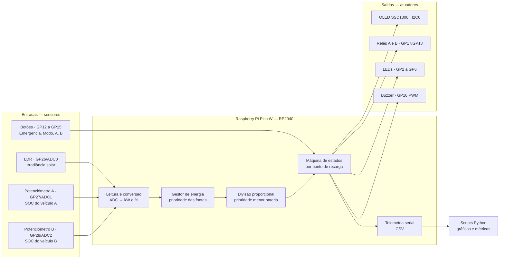
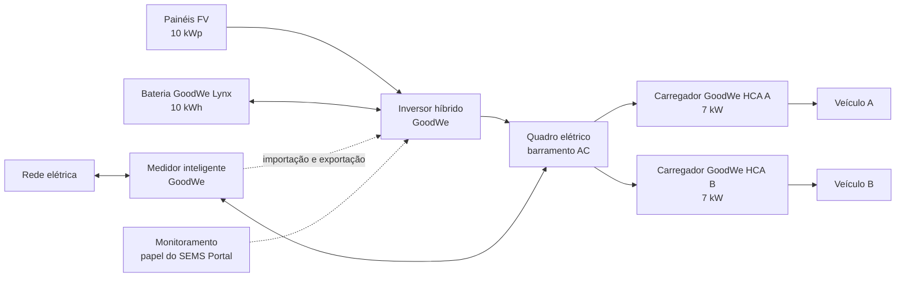
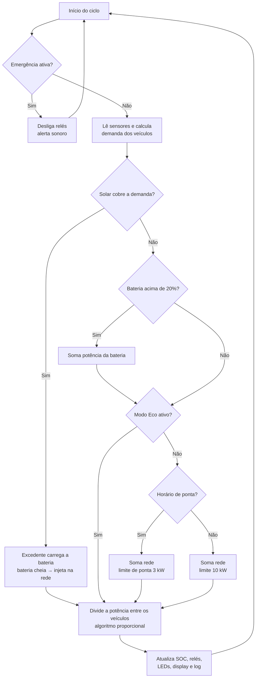
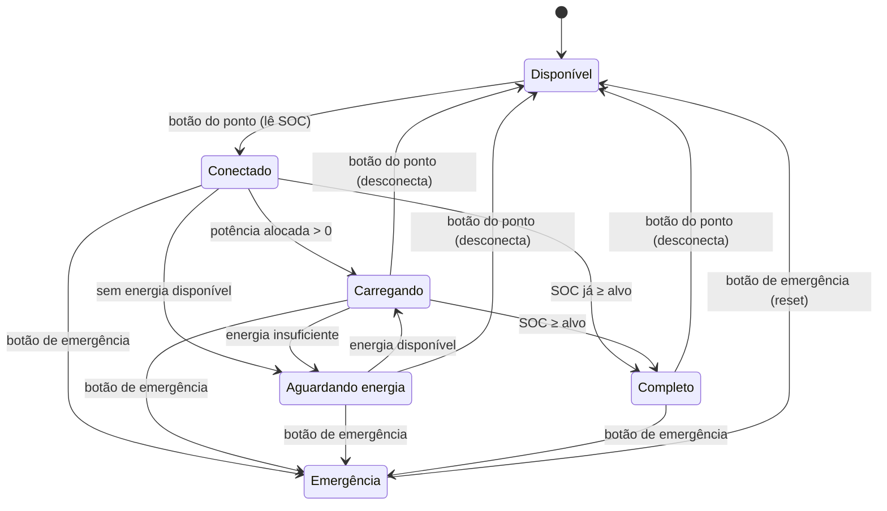

# Arquitetura da Solução — SolarFlow

Estação inteligente de recarga de veículos elétricos com geração solar, armazenamento em bateria e gestão automática de energia, baseada no ecossistema GoodWe e simulada no Wokwi com Raspberry Pi Pico W (RP2040) e MicroPython.

## 1. Visão geral

A estação possui **dois pontos de recarga** alimentados por três fontes, nesta ordem de prioridade:

1. **Energia solar** (painéis fotovoltaicos + inversor híbrido)
2. **Bateria estacionária** (armazena o excedente solar)
3. **Rede elétrica** (complemento, com restrição no horário de ponta)

Quando os veículos e a bateria não conseguem absorver toda a geração solar, o excedente é **injetado na rede**, gerando créditos de energia.

Um microcontrolador lê os sensores, decide de onde vem a energia, divide a potência entre os veículos com prioridade para quem tem menos bateria, aciona os contatores (relés) e envia telemetria para análise.

## 2. Camadas do sistema

| Camada | Função | Implementação na simulação |
|---|---|---|
| Geração | Produzir energia renovável | Sensor LDR mede a irradiância solar |
| Armazenamento | Guardar excedente e suprir déficit | Bateria modelada em software (SOC, carga e descarga) |
| Recarga | Entregar energia aos veículos | 2 pontos de recarga com relés (contatores) |
| Rede | Complementar quando falta energia e receber o excedente | Limite contratado + regra de horário de ponta + injeção do excedente |
| Controle | Decidir e automatizar | Firmware MicroPython no RP2040 |
| Interface local | Informar o usuário | Display OLED, LEDs e buzzer |
| Monitoramento | Registrar e analisar dados | Telemetria serial (CSV) + scripts Python de gráficos |

## 3. Mapeamento com as tecnologias GoodWe

| Parte do sistema | Na simulação | Equivalente GoodWe | Por que essa tecnologia |
|---|---|---|---|
| Geração solar | LDR (irradiância) | Painéis FV + inversor híbrido GoodWe | O inversor híbrido integra FV, bateria e rede em um único equipamento |
| Armazenamento | Modelo de bateria em software | Bateria GoodWe Lynx Home | Guarda o excedente do dia para recarga quando não há sol |
| Pontos de recarga | Relés + lógica de alocação | Carregador GoodWe EV linha HCA (7 kW) | Suporta recarga por excedente solar e gerenciamento de carga |
| Medição de excedente | Calculada em software (geração − consumo) | Medidor inteligente GoodWe | Mede importação e exportação na entrada da rede; base da recarga por excedente |
| Gestão de energia | Algoritmo no RP2040 | Gerenciamento de carga do sistema GoodWe | Mesma lógica: priorizar solar e respeitar limites de potência |
| Parada de emergência | Botão de emergência | Parada de emergência do carregador HCA | Segurança: corta a recarga imediatamente |
| Monitoramento | Display + telemetria CSV + gráficos | SEMS Portal e app GoodWe | Acompanhamento dos processos de recarga e dos fluxos de energia |

## 4. Parâmetros da simulação

Todos ficam no arquivo `config.py` e podem ser ajustados.

| Parâmetro | Valor padrão |
|---|---|
| Potência solar máxima (irradiância 100%) | 10 kWp |
| Capacidade da bateria estacionária | 10 kWh |
| Potência máx. de carga/descarga da bateria | 5 kW |
| SOC mínimo da bateria (proteção) | 20% |
| Potência máxima por ponto de recarga | 7 kW (referência: GoodWe HCA 7 kW) |
| Capacidade da bateria de cada veículo | 50 kWh |
| SOC alvo de cada veículo | 80% |
| Limite de importação da rede (fora de ponta) | 10 kW |
| Limite de importação da rede (horário de ponta) | 3 kW |
| Horário de ponta | 18h às 21h |
| Escala de tempo | 1 s real = 5 min simulados |

Atualização do SOC a cada ciclo:

```
ΔSOC (%) = (Potência recebida (kW) × Δt (h) / Capacidade (kWh)) × 100
```

## 5. Hardware e mapa de pinos (Raspberry Pi Pico W)

| Componente (Wokwi) | Pino | Periférico do RP2040 | Função |
|---|---|---|---|
| OLED SSD1306 128×64 | GP0 (SDA), GP1 (SCL) | I2C0 | Painel local de status |
| LED verde — ponto A | GP2 | GPIO saída | Ponto A carregando |
| LED verde — ponto B | GP3 | GPIO saída | Ponto B carregando |
| LED amarelo | GP4 | GPIO saída | Energia vinda do sol |
| LED azul | GP5 | GPIO saída | Energia vinda da bateria |
| LED vermelho | GP6 | GPIO saída | Energia vinda da rede |
| Botão emergência | GP12 | GPIO entrada (pull-up) | Parada de emergência |
| Botão modo | GP13 | GPIO entrada (pull-up) | Alterna Modo Normal / Modo Eco |
| Botão ponto A | GP14 | GPIO entrada (pull-up) | Conectar/desconectar veículo A |
| Botão ponto B | GP15 | GPIO entrada (pull-up) | Conectar/desconectar veículo B |
| Buzzer | GP16 | PWM | Alertas sonoros |
| Relé — ponto A | GP17 | GPIO saída | Contator do ponto A |
| Relé — ponto B | GP18 | GPIO saída | Contator do ponto B |
| Sensor LDR (módulo) | GP26 | ADC0 | Irradiância solar |
| Potenciômetro A | GP27 | ADC1 | SOC do veículo A na conexão |
| Potenciômetro B | GP28 | ADC2 | SOC do veículo B na conexão |

Todos os LEDs usam resistor de 220 Ω. Sensores analógicos alimentados em 3V3.

### Decisões de arquitetura

- **Limite de canais ADC:** o RP2040 tem apenas 3 entradas analógicas disponíveis para o usuário (GP26, GP27, GP28). Por isso, os sensores analógicos ficam para as grandezas físicas que vêm "de fora" (sol e SOC na conexão), e o SOC durante a recarga e o SOC da bateria estacionária são calculados em software.
- **ADC de 12 bits:** o MicroPython entrega a leitura em 16 bits (`read_u16`, 0 a 65535), que é convertida para porcentagem e para kW.
- **I2C para o display:** usa só 2 fios para um display completo, economizando pinos.
- **PWM para o buzzer:** permite gerar tons diferentes para cada tipo de alerta.
- **Pull-up interno nos botões:** dispensa resistores externos; o botão fecha o contato com o GND.
- **Relés como contatores:** isolam o circuito de controle (3,3 V) do circuito de potência, como em um carregador real.

## 6. Diagrama de arquitetura (controle)



## 7. Fluxo de energia (sistema real equivalente)

Os carregadores HCA são AC e ficam ligados ao quadro elétrico, em paralelo com a rede. O inversor híbrido converte a energia dos painéis e da bateria para AC e entrega no mesmo quadro. O medidor inteligente, na entrada da rede, mede importação e exportação: é essa medição que permite saber quanto excedente solar existe para a recarga.



## 8. Lógica de decisão a cada ciclo

A rede entra apenas com a parte que ainda falta depois de solar e bateria.



## 9. Máquina de estados de cada ponto de recarga



A emergência é global: desliga os dois pontos ao mesmo tempo. Depois do reset, os veículos precisam ser reconectados.

## 10. Algoritmo de divisão proporcional com prioridade pela menor bateria

A potência disponível é dividida de forma proporcional à **energia que falta** para cada veículo chegar ao SOC alvo. Quem tem menos bateria precisa de mais energia, então recebe uma fatia maior.

1. Para cada veículo conectado: `falta_i = alvo − SOC_i`
2. Peso de cada veículo: `peso_i = falta_i / soma(falta)`
3. Potência alocada: `P_i = P_disponível × peso_i`, limitada a 7 kW por ponto
4. Se algum ponto bater no limite, a sobra é redistribuída entre os demais

**Exemplo:** 10 kW disponíveis, veículo A com 20% e veículo B com 60% (alvo 80%).
Faltas: A = 60, B = 20 → pesos 75% e 25% → A = 7,5 kW (limitado a 7 kW), B = 2,5 kW → a sobra de 0,5 kW vai para B → **A = 7 kW, B = 3 kW**.
